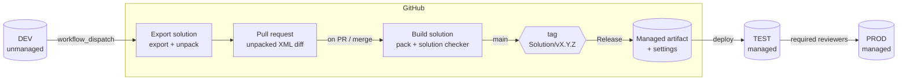

# power-platform-alm

[](https://github.com/mateusmirandaia/power-platform-alm/actions/workflows/build-solution.yml)
[](https://github.com/mateusmirandaia/power-platform-alm/actions/workflows/release.yml)
[](https://github.com/mateusmirandaia/power-platform-alm/actions/workflows/lint.yml)
[](LICENSE)

Application lifecycle management for Dataverse / Dynamics 365 solutions with
GitHub Actions and the Power Platform CLI: export from DEV, review the unpacked
source in a pull request, build and check a managed package, and promote that
same package through TEST and PROD behind approvals.

## Why bother

Most Dynamics 365 projects start with someone exporting a zip from DEV and
importing it into PROD by hand. That works until it doesn't:

- Nobody can say what changed between two releases, because the release is a
  binary blob on someone's laptop.
- An unmanaged import into PROD lets people customize production directly,
  and those changes are overwritten (or block the next import) without warning.
- Environment variables and connection references get fixed by hand after
  each import, and the flows that depend on them sit turned off until a user
  notices.
- The person who built the change is also the one who deploys it, at 6 pm.

This repository turns that into a pipeline where every change is a reviewed
diff, every deployment is the same artifact that was tested, and production
needs someone else's approval.

## How it flows



## Workflows

| Workflow | Trigger | What it does |
|----------|---------|--------------|
| [Export solution](.github/workflows/export-solution.yml) | Manual | Publishes customizations in DEV, exports unmanaged and managed, unpacks both into `solutions/<Name>/src`, refreshes deployment settings, opens a PR. |
| [Build solution](.github/workflows/build-solution.yml) | PR and push to `main` touching `solutions/**` or `deployment-settings/**` | Detects which solutions changed, packs managed and unmanaged, runs solution checker, uploads the artifact. |
| [Release](.github/workflows/release.yml) | Tag `<Solution>/v*` or manual | Builds once with the tag's version, imports into TEST, waits for approval, imports into PROD. |
| [Lint](.github/workflows/lint.yml) | PR and push touching workflows, scripts or settings | actionlint, yamllint, PSScriptAnalyzer and a shape check of the settings files. |
| [_build.yml](.github/workflows/_build.yml), [_deploy.yml](.github/workflows/_deploy.yml) | `workflow_call` | Reusable building blocks used by the workflows above. |

The [setup-pac](.github/actions/setup-pac/action.yml) composite action installs
the CLI and, when given an environment, does a WhoAmI first so a broken
credential fails in seconds instead of halfway through an import.

## Repository layout

```
.github/
  actions/setup-pac/      install pac, verify the connection
  workflows/              export, build, release, lint + reusable _build/_deploy
deployment-settings/      test.json, prod.json (connection refs, env variables)
docs/                     setup, branching strategy, troubleshooting
scripts/                  PowerShell 7 helpers used by the workflows and locally
solutions/
  CoreCustomizations/src  sample unpacked solution (replace with yours)
```

## Quickstart

1. Create an app registration and an application user in DEV, TEST and PROD
   ([docs/setup.md](docs/setup.md)).
2. Create the GitHub environments `dev`, `test` and `prod`, add required
   reviewers to `prod`, and set the variables below.
3. Run **Export solution** with your solution's unique name. Review and merge
   the PR it opens; fill in any new deployment settings on that branch.
4. Release:

   ```bash
   git tag CoreCustomizations/v1.0.0
   git push origin CoreCustomizations/v1.0.0
   ```

5. Approve the PROD deployment when TEST looks good.

Working locally with the same tooling:

```powershell
# bump the version committed in source
./scripts/Set-SolutionVersion.ps1 -SolutionFolder solutions/CoreCustomizations/src -Bump Minor

# add new environment variables / connection references to every settings file
./scripts/New-DeploymentSettings.ps1 -SolutionFolder solutions/CoreCustomizations/src

# check a settings file the same way the release does
./scripts/Test-DeploymentSettings.ps1 -SettingsFile deployment-settings/test.json `
    -SolutionFolder solutions/CoreCustomizations/src
```

## Configuration

| Name | Kind | Scope | Notes |
|------|------|-------|-------|
| `PP_TENANT_ID` | Variable | Repository | Entra tenant ID. |
| `PP_APP_ID` | Variable | Repository, override per environment | Client ID of the service principal. Use a separate one for `prod`. |
| `PP_ENVIRONMENT_URL` | Variable | `dev`, `test`, `prod` | e.g. `https://yourorg-test.crm.dynamics.com` |
| `PP_CHECKER_ENVIRONMENT_URL` | Variable | Repository | Environment the solution checker authenticates against, usually DEV. |
| `PP_CHECKER_GEO` | Variable | Repository | Optional, defaults to `UnitedStates`. |
| `PP_PAC_VERSION` | Variable | Repository | Optional, pins the Power Platform CLI. |
| `PP_CLIENT_SECRET` | Secret | Repository or environment | Only for client-secret auth. Leave unset to use OIDC. |
| `ALM_BOT_CLIENT_ID` / `ALM_BOT_PRIVATE_KEY` | Variable / Secret | Repository | Optional GitHub App so export PRs trigger the build. |

Authentication uses a service principal. With **OIDC** (workload identity
federation) there is no secret at all: add federated credentials for the
subjects listed in [docs/setup.md](docs/setup.md#option-a-oidc--workload-identity-federation-recommended)
and leave `PP_CLIENT_SECRET` unset. With a **client secret**, set
`PP_CLIENT_SECRET` and rotate it before it expires. The workflows do not need
to change between the two.

Values in `deployment-settings/` are placeholders (all-zero GUIDs,
`example.com` URLs). The release refuses to import while a connection
reference still has the placeholder ID.

## Design decisions

**Managed downstream, unmanaged only in DEV.** Managed solutions can be
upgraded and uninstalled cleanly, keep layering predictable, and stop people
from customizing TEST and PROD directly. Imports use stage-and-upgrade so
components deleted in DEV are also removed downstream.

**Unpacked source is the source of truth.** Zips are build output and are
git-ignored. The export unpacks with `solution-type: Both` so the same source
can produce the managed package for downstream and an unmanaged one to rebuild
DEV. The export clears the folder before unpacking, otherwise deleted
components would linger in Git.

**Build once, deploy many.** A release packs a single artifact and promotes it.
PROD receives byte-for-byte what TEST received, and the deployment settings
are bundled into that artifact from the tagged commit.

**Settings files per environment.** Connection references and environment
variable values live in `deployment-settings/<env>.json`, reviewed like code.
Secret values do not belong there; use environment variables of type *Secret*
backed by Azure Key Vault. A solution can have its own folder
(`deployment-settings/<Solution>/<env>.json`) when the repo grows beyond one.

**Approvals live in GitHub environments.** Required reviewers, self-review
prevention and the tag rule are configured on the `prod` environment, outside
the workflow files, so a pull request cannot remove them.

**Least privilege.** The default token is read-only; jobs ask for
`id-token: write` only where they authenticate and `contents: write` only in
the export. Imports into the same environment are queued, never cancelled
mid-flight.

**Official actions where they exist.** `microsoft/powerplatform-actions@v1`
covers export, unpack, pack, check and import. pac is called directly only
for things the actions do not wrap (`solution create-settings`).

## Roadmap

- Build and test plug-in assemblies and PCF controls (`dotnet build`,
  `pac pcf`) as part of the solution build.
- Post-deployment smoke tests against TEST (Web API calls, flow state checks).
- Turn on flows and share canvas apps after import from a manifest.
- Create a GitHub Release with the managed zip and generated notes when PROD
  succeeds.
- Pipelines in Power Platform (managed environments) as an alternative
  promotion path, keeping Git as the source of truth.
- Data migration for configuration tables with the Configuration Migration
  tool (`pac data`).

## Documentation

- [Setup guide](docs/setup.md): app registration, application users, roles,
  GitHub environments, variables and secrets.
- [Branching strategy](docs/branching-strategy.md): trunk-based flow, versioning,
  hotfixes.
- [Troubleshooting](docs/troubleshooting.md): auth, export, checker and import
  errors.

## License

[MIT](LICENSE)
